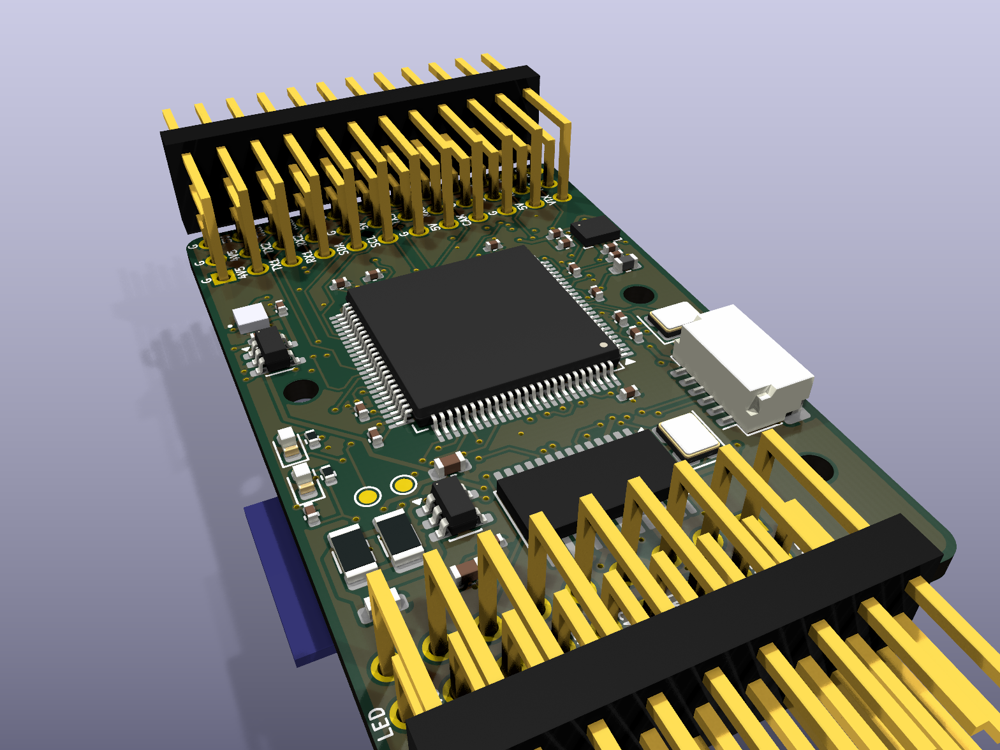
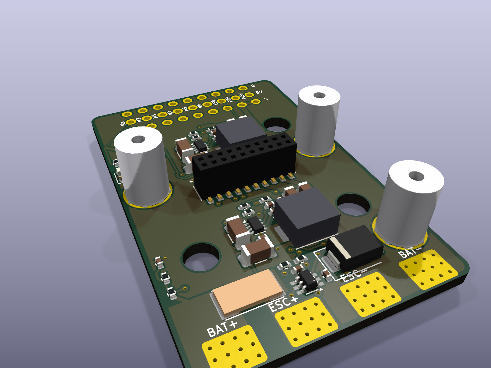
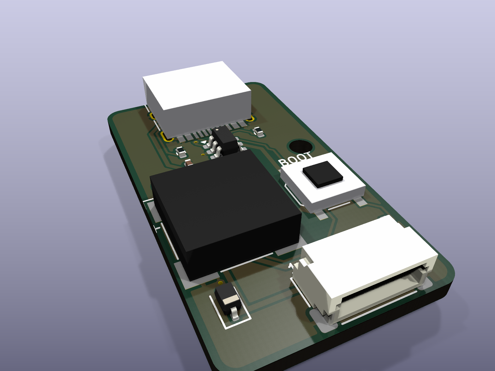

# StackF765

An open-hardware **ArduPilot flight controller** built around the STM32F765:
two stacked 31.5 × 48 mm boards on a 20 × 20 mm mount, plus a small USB / buzzer / boot
board on a cable. Flight-controller connections are labelled 0.1 inch right-angle header pins; motor outputs are labelled solder holes on the lower board.

**[3D project page](https://peterjburke.github.io/stackf765/)** ·
**[Drone viewer](https://peterjburke.github.io/stackf765/drone/)** ·
[Pinout](docs/pinout.md) · [How it works](docs/design.md) · [Order boards](docs/manufacturing.md) ·
[Assemble](docs/assembly.md) · [First power-up](docs/bringup.md) · [Firmware](docs/firmware.md) ·
[Verification](docs/verification.md)

| Upper board (flight controller) | Lower board (power) | Service board |
|---|---|---|
|  |  |  |

> **Status: design complete and verified by rule checks; no hardware has been built yet.**
> The first boards are prototypes. Use the [first power-up procedure](docs/bringup.md).

## At a glance

| | |
|---|---|
| Processor | STM32F765VIT6, 216 MHz Cortex-M7, 2 MB flash |
| Firmware | ArduPilot (Copter, Plane, Rover), board name `StackF765` |
| Sensors | ICM-45686 IMU (SPI), BMP388 barometer (I2C) |
| Battery | 2S–3S LiPo (6–13 V), 50 A continuous through a 0.5 mΩ shunt |
| Serial | 7 UARTs + USB |
| Outputs | 6 motor/servo outputs on standard 3-pin columns (signal / 5 V / ground), addressable LED |
| Video | Analog OSD (AT7456E), camera in / VTX out |
| Logging | microSD |
| 5 V rails | 3 A for the flight controller and peripherals, a separate 3 A for a companion computer |
| Size | 31.5 × 48 × about 19 mm, 20 × 20 mm grommet mount |

## Pinout in brief

Upper board header, seen from above with the header pointing away from you:

| Row | 1 | 2 | 3 | 4 | 5 | 6 | 7 | 8 | 9 | 10 | 11 | 12 |
|---|---|---|---|---|---|---|---|---|---|---|---|---|
| front edge | G | 5V | TX6 | RX6 | G | 5V | TX7 | RX7 | G | 5V | TX8 | RX8 |
| middle | G | 4V5 | TX2 | RX2 | G | 5V | TX3 | RX3 | G | 5V | TX4 | RX4 |
| inner | G | 4V5 | TX1 | RX1 | SDA | SCL | G | 5V | CAM | G | 5V | VTX |

Lower board solder holes (no header fitted), columns left to right: `M1 M2 M3 M4 M5 M6 LED PI5V PI5V`; each column is signal / 5 V / ground from the inner row to the board edge.
Power pads at the rear: `BAT+ ESC+ ESC− BAT−`. Full details: [docs/pinout.md](docs/pinout.md).

## What is in this repository

| Folder | Contents |
|---|---|
| `hardware/` | KiCad 9 projects for the three boards (schematics and routed PCBs), custom footprints and 3D models |
| `fab/` | Gerbers, drill files, bills of materials and placement files, ready to upload |
| `firmware/` | ArduPilot board definition (`hwdef`), build script, prebuilt binaries |
| `docs/` | Documentation, schematic PDFs, renders, and the web pages |
| `gen/` | The Python design files the KiCad projects are generated from, and the generator |
| `tools/` | Verification scripts |
| `research/` | Part selection notes, datasheet checks, and the independent design review |

## How the design is made

The circuits are written as short Python files (`gen/upper.py`, `gen/lower.py`,
`gen/service.py`). `make` turns them into KiCad schematics and boards, places and routes
the parts, fills the copper, runs KiCad's own rule checks, and writes the fabrication files,
renders and web pages. Because one description produces both schematic and board, they cannot
drift apart, and KiCad checks that they match.

You do not need the generator to use the design: open `hardware/<board>/<board>.kicad_pro`
in KiCad 9 and work on it like any other project.

```sh
make            # regenerate everything (needs KiCad 9, Python 3, gcc)
make verify     # run all checks on the committed files
make firmware ARDUPILOT=/path/to/ardupilot
```

## Verification summary

Every board passes KiCad ERC and DRC with zero violations and zero unconnected nets, the
board matches the schematic, the 49 microcontroller pins used by the firmware are cross-checked
against the schematic, the boards are checked to fit together, and ArduPilot builds for the
board. See [docs/verification-report.md](docs/verification-report.md) for the current results
and [docs/verification.md](docs/verification.md) for what those checks do and do not cover.

## Licence

Hardware: [CERN-OHL-P v2](LICENSE-HARDWARE.txt). Software, scripts and documentation: [MIT](LICENSE).
The drone frame model and coin used in the drone viewer are third-party assets; see
`docs/drone/assets/CREDITS.txt`.
